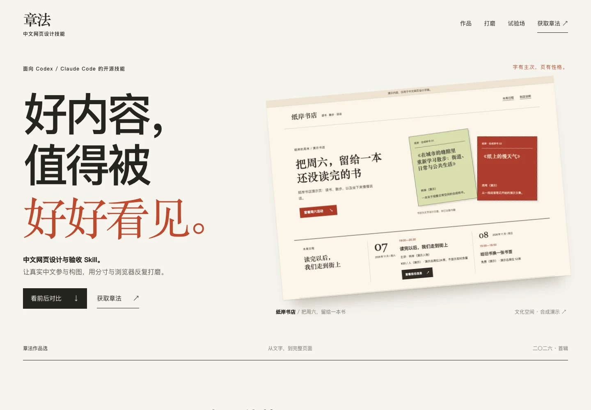
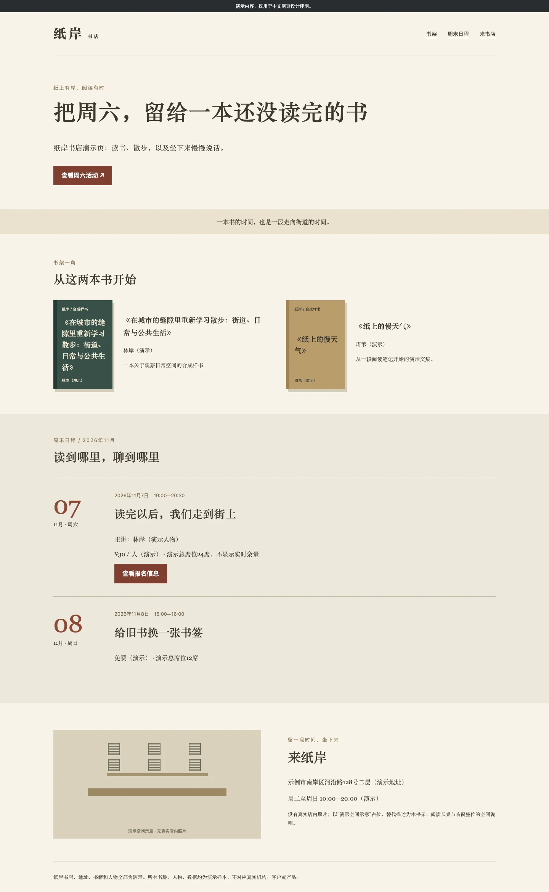
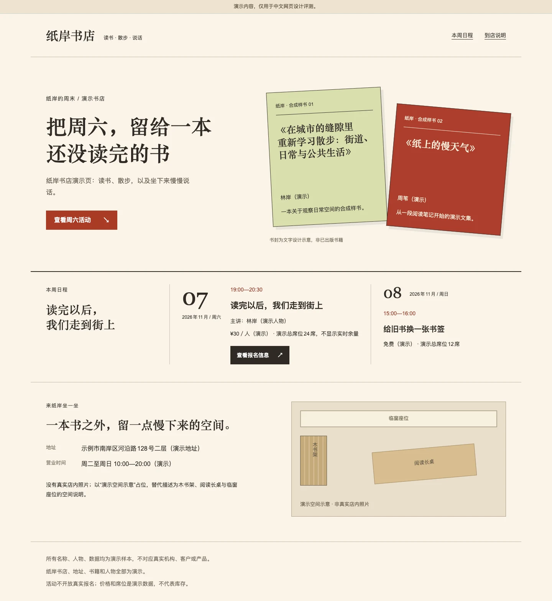
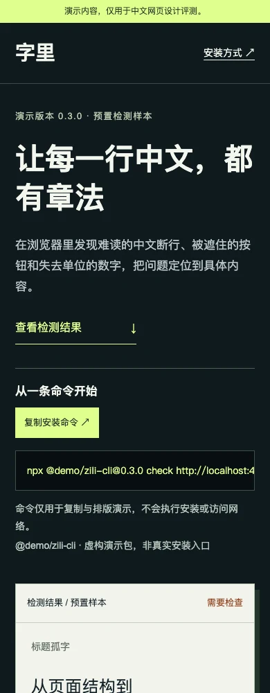
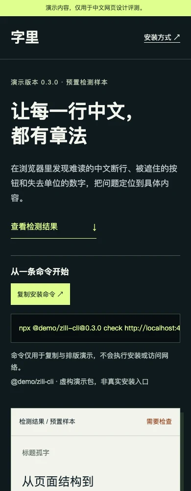
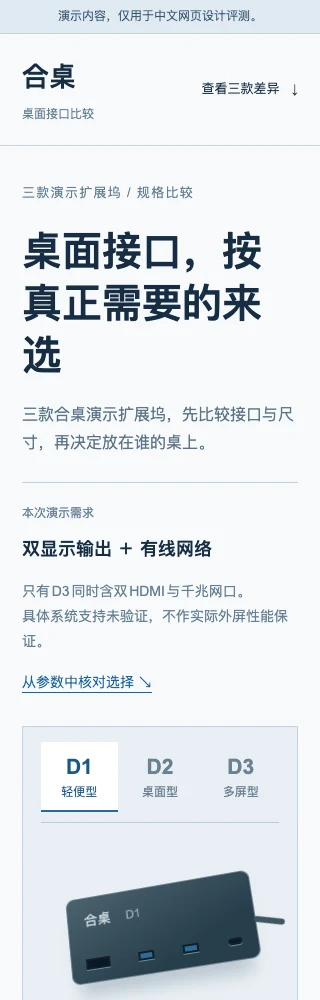
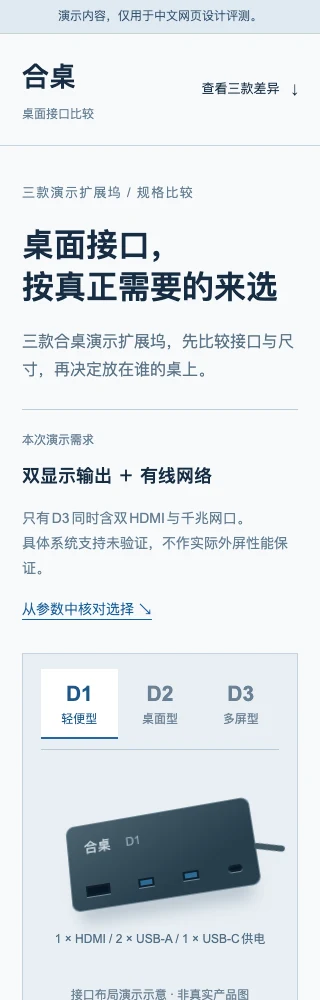

# 章法

**面向中文网页的设计与验收 Skill。**

好内容，值得被好好看见。

`blcaptain-zhangfa` 是爆裂队长面向中文网页的开源设计技能，适用于 Codex、Claude Code 等能读取 `SKILL.md` 的智能体。

给它真实内容，它会先梳理读者的任务，再设计页面结构、中文排印和视觉主次，结合「分寸」在浏览器里测量、检查、打磨。从零做页面、保留功能改旧页、只审不改，都能用。

[浏览作品与五组同窗前后对比](https://dososo.github.io/blcaptain-zhangfa/) · [下载技能包](https://github.com/dososo/blcaptain-zhangfa/releases) · [12组中文局部试排](https://dososo.github.io/blcaptain-zhangfa/lab/)



## 中文，值得单独设计

“为什么”被拆成“为什／么”，一个“选”独占一行，书名在窄屏上碎成几截。页面能打开，文字却读得别扭。

章法把这些细节放进设计过程：用真实长标题试排，按语义组织断行，让数字和单位保持关系；到了手机和平板，重新安排内容的先后、密度与动作。中文长文、活动报名、产品工具、规格比较和管理工作台，各有自己的阅读方式。

它适合用 AI 做中文页面的独立开发者、产品团队与内容创作者。尤其适合这些时刻：

- **从零做页：** 先比较有实质差异的关键片段，再深化入选方向，让内容拥有自己的面孔。
- **改好旧页：** 保留数据、字段、路由和主要行为，打磨层次、排印与响应布局。
- **交付前审阅：** 看真实页面、实际断行和操作状态，给出能定位、能复查的问题。

## 从整页结构，到一行中文

先看 [纸岸书店完整页面对比](https://dososo.github.io/blcaptain-zhangfa/story/)：同一份冻结内容，书籍从列表走进首屏成为主对象，日程接住主要动作，到店说明收尾。桌面与手机均可切换完整截图，也可打开两边页面操作报名演示。

| 无本技能 · 原始页 | 章法＋分寸 · 修订页 |
|---|---|
| [](https://dososo.github.io/blcaptain-zhangfa/runs/05/control/) | [](https://dososo.github.io/blcaptain-zhangfa/runs/05/full/) |

这是不同生成条件的精选产物，章法一侧包含0.2.0后期视觉修订，不能当成单次改版或首次生成胜率。两边完整书名、活动时间、费用、席位、报名条件与到店信息均保留；1440px和390px实际验证打开说明、收起和焦点返回。[截图来源](site/assets/story/来源.json)。

## 同一个页面，再认真看一遍

0.2.0 对 20 个章法实施页做了四种宽度的独立模型视觉审查，并对其中 13 页作针对修复。下面选三组：原文相同、视口相同、均从页面顶部取景。每对缩略图同步缩放，可打开原图查看。

| 场景与变化 | 修复前 | 修复后 |
|---|---|---|
| **工具页 · 390px**<br>让“都／有”回到完整短语中，保留标题的重心。 |  |  |
| **中文长文 · 390px**<br>“为什么”完整地问，“停在门外”完整地说；全文保留。 |  |  |
| **商品比较 · 320px**<br>把孤零零的“选”放回句子，三款参数仍可比较。 |  |  |

[同一窗口切换全部五组修复前后](https://dososo.github.io/blcaptain-zhangfa/#refinements)，包括平板上的书店活动页与城市步行报名页。0.3.0 改为固定窗口切换，保留观察位置，不必上下寻找另一张长图；可用按钮、键盘左右方向键或 Home/End，并打开完整图与实际页面。

这些是根据独立模型审查反馈迭代完成的同页修复，属于精选展示。原始页面保留在 [0.1.0 历史目录](site/history/v0.1.0/runs/)，另外两组对照及冻结输入保持原样。当前章法页面属于 0.2.0 修订版，不能据此计算首次生成或视觉偏好胜率。过程与验证状态见 [视觉修订记录](docs/0.2.0-视觉修订.md)。

## 有章可循，也有变化的余地

章法的六步判断：**明事 → 成章 → 量字 → 造境 → 验真 → 复核**。

先确定谁来阅读、要解决什么，再组织信息；用真实中文决定行宽、断点和节奏；让产品、作品、图表、界面或文字成为页面的主角。实现后运行页面和主要任务，再独立复看整体与细节。

分寸提供中文排版的可测量依据。章法负责把测量带回设计决定：该改容器、重排列，还是保护一段语义；该保留宽表格，还是调整操作顺序。规则结果、设计意见与人类体验分别记录。

0.3.0 把执行约定补进流程：开工说明模式、主任务、保留内容与验证范围；方向探索留下可回看的真实片段；交付逐项核对实际结果。用户已经选定方向或只修局部时可合理简化，缺环境或未执行的检查明确披露。它改善的是执行约束，效果仍需真实任务持续检验。

[阅读技能入口](skills/blcaptain-zhangfa/SKILL.md) · [方法与边界](docs/方法与边界.md)

## 安装与开始

先克隆仓库：

```bash
git clone https://github.com/dososo/blcaptain-zhangfa.git
```

将 `skills/blcaptain-zhangfa` **整个目录**复制到你的项目：

| 工具 | 项目内安装目录 | 显式调用 |
|---|---|---|
| Codex | `.agents/skills/blcaptain-zhangfa/` | `$blcaptain-zhangfa` 加需求 |
| Claude Code | `.claude/skills/blcaptain-zhangfa/` | `/blcaptain-zhangfa` 加需求 |

也可从 [版本页](https://github.com/dososo/blcaptain-zhangfa/releases) 下载 ZIP 后安装。请保留 `references/`、`scripts/`、`agents/`、`LICENSE` 与 `NOTICE`；如已有同名技能，先比较内容。

重启或重新加载工具，确认它实际发现技能。自动触发由宿主机制决定。试着给出一个具体任务：

```text
使用 $blcaptain-zhangfa 改进这个中文活动页。
保留日期、票种、条款和报名行为。
先检查真实页面，再改善视觉主次、标题断行和手机布局。
```

从零创建时，说明读者、主要动作、真实内容与品牌约束；只想审阅时，明确“只审不改”。卸载时移走本次安装的技能目录即可。

## 接上分寸，检查真实页面

设计指令本身可以直接使用。要取得浏览器测量、截图和检查报告，项目需要 Node.js 20.19 或更高版本、系统 Chrome，以及本地依赖：

```bash
npm install --save-dev measure-cjk@0.1.0 playwright-core@1.64.1
```

这条安装命令会联网并修改当前项目依赖文件；检查器不会自动安装或升级。已有项目先遵循其包管理约定。

启动页面后，从项目目录运行：

```bash
node <技能目录>/scripts/check-page.mjs --url http://localhost:5173 --out evidence/zhangfa
```

把 `<技能目录>` 替换为安装目录的绝对路径，端口换成实际端口。完整选项：

```bash
node <技能目录>/scripts/check-page.mjs --help
```

检查器覆盖指定宽度下的部分溢出、文字裁切、坏图、常见控件名称与页面异常，并调用固定版本分寸。截图前会在有界范围内真实滚动以触发当前可展示的懒加载图片，再恢复观察位置；隐藏图片单列未检查，持续未完成的资源保留未知，真实坏图仍报失败。每轮保存独立报告和截图，根 `report.json` 指向最新结果。标题探针只采集前 12 个可见横排 `h1/h2`；导航、主动作、图示标注和动态反馈需按任务另行观察。

项目已有 `measure.config.json` 时保留其规则。分寸 0.1.0 要求配置与证据在同一根内，证据目录应放在项目内；配置冲突明确返回未知。

默认只访问回环地址；远端网页及资源需显式使用 `--allow-remote`。检查结果留在本地，不写全局配置、不启用遥测、不上传结果。

| 状态 | 含义 |
|---|---|
| `pass` | 请求范围的自动检查已执行并通过 |
| `fail` | 有可定位的失败 |
| `not_run` | 未执行或缺环境 |
| `unknown` | 不能可靠判断 |
| `not_applicable` | 确认不适用 |

展示站的少量大字负字距、章节索引小字和标题试排行高属于明确的设计取舍，默认分寸规则仍会报告相关问题；不据此宣称全站规则零错误。测量结果与视觉审查分别判断，见 [0.3.0记录](docs/0.3.0-展示与稳定性.md)。

CLI 退出码：0 为自动检查通过，1 为页面或规则失败，2 为环境、参数、未知或未运行。复杂读屏、语义判断、人类审美和真实手机体验分别验收；未完成的部分标记 `MANUAL_PENDING`。

## 在案例里亲自试

[试验场](https://dososo.github.io/blcaptain-zhangfa/#playground) 收录 24 个场景、三种条件的 60 个页面与 12 份审阅报告；另有 [12 组可操作局部示意](https://dososo.github.io/blcaptain-zhangfa/lab/)，可以试断行、混排、焦点和错误恢复。

案例中的机构、人物、商品、价格与数据均为合成演示，本地模拟操作不产生真实业务。原始批次的上下文共享、流程省略、额外修复与失败记录均有保留；完整模型构建版本和统一成本未暴露，因此不报告统计胜率或业务提升。

[生成与评测协议](bench/协议.md) · [0.1.0 原始交付记录](docs/交付与可验证说明.md) · [0.2.0 修订记录](docs/0.2.0-视觉修订.md) · [0.3.0 展示与稳定性记录](docs/0.3.0-展示与稳定性.md)

## 本地开发与许可

```bash
npm ci --ignore-scripts
npm run serve
npm test
npm run verify
npm run pack:skill
```

预览地址为 `http://127.0.0.1:4179`，测试需要系统 Chrome。技能 ZIP 与校验和生成在 `release/`；相同内容可重现同一归档。研究档案、缓存、内部任务与本机原始运行日志不进入技能包。

技能入口、功能性参考与工程代码采用 [Apache-2.0](LICENSE)；中文说明、原创案例与展示内容采用 [CC BY 4.0](LICENSE-docs)。详见 [许可分工](NOTICE) 与 [第三方说明](docs/第三方说明.md)。不分发第三方字体文件；系统调用、自托管和再分发权限分别核验。

欢迎带着真实中文、可复现任务和失败证据来改进章法。下一个有自己面孔的页面，从你的内容开始。
